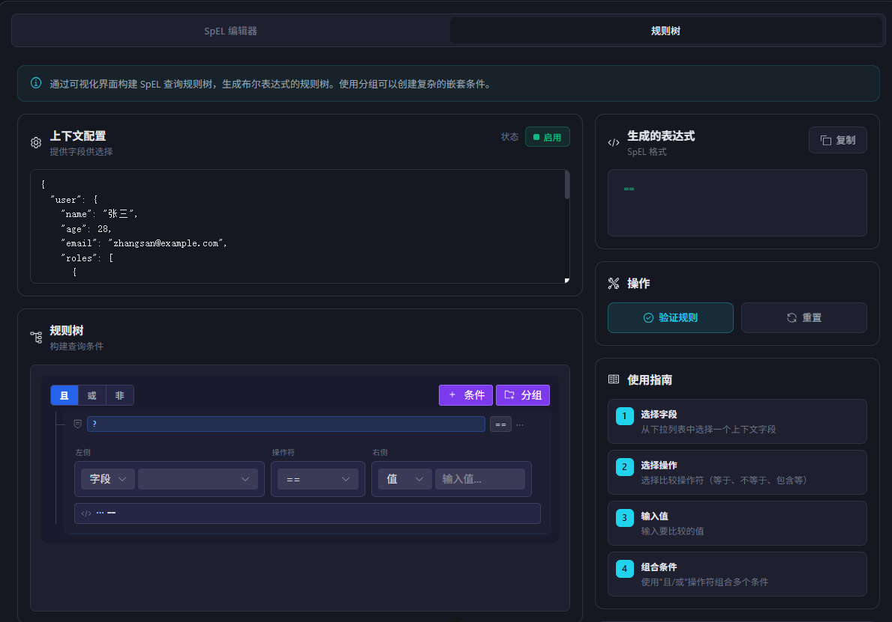
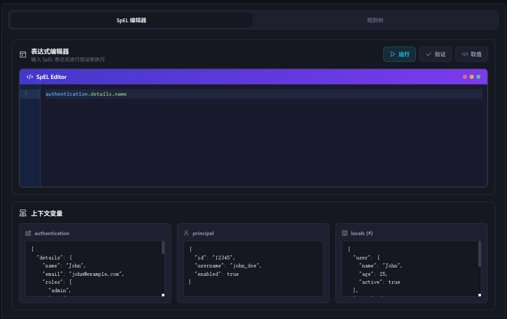

[English](./README.en.md) | [中文](./README.md)

# Vue SpEL Query Builder

A Vue 3 SpEL (Spring Expression Language) query builder that ships a code editor and a visual rule tree, so you can build boolean SpEL expressions either by code or through a visual interface.

## Features

- **SpEL Editor**: a CodeMirror-based code editor with syntax highlighting, context-aware autocomplete, type hints, and expression execution
- **Visual Rule Tree**: build complex boolean rule trees through drag-free point-and-click operations, no code required
- **Two-way Conversion**: rule trees can generate SpEL expressions, and expressions written in the editor can be visualized
- **Context-aware**: supports `authentication`, `principal`, and `locals` context variables with intelligent suggestions
- **Theme Switching**: built-in light and dark themes
- **Multiple Sizes**: `tiny`, `small`, `medium`, and `large` size options
- **Internationalization**: built-in Chinese (`zh`) / English (`en`) message packs, switchable globally, via component props, or through a config context
- **TypeScript**: complete TypeScript type definitions

## Installation

```bash
npm install @zeng-alt/vue-spel-query-builder
# or
yarn add @zeng-alt/vue-spel-query-builder
# or
pnpm add @zeng-alt/vue-spel-query-builder
```

## Peer Dependencies

The library depends on the following peer dependencies (npm 7+ installs them automatically; you can also install them manually):

```bash
npm install vue@^3.5.0 naive-ui@^2.44.0 \
  @codemirror/autocomplete@^6.20.0 \
  @codemirror/commands@^6.10.3 \
  @codemirror/language@^6.9.2 \
  @codemirror/state@^6.5.2 \
  @codemirror/view@^6.38.2 \
  @lezer/highlight@^1.2.0
```

> **Note**: `RuleTree` uses naive-ui internally. naive-ui is imported directly inside the component, so you only need to install the peer dependency — no need to register it globally with `app.use(naive)`.
>
> If you also use naive-ui components in your own templates, it is recommended to import them on demand with [`unplugin-vue-components`](https://github.com/unplugin/unplugin-vue-components):
>
> ```ts
> // vite.config.ts
> import Components from 'unplugin-vue-components/vite'
> import { NaiveUiResolver } from 'unplugin-vue-components/resolvers'
>
> export default {
>   plugins: [
>     // ...
>     Components({
>       resolvers: [NaiveUiResolver()],
>     }),
>   ],
> }
> ```

> **Note**: You must import the style file before using the components:
>
> ```ts
> import '@zeng-alt/vue-spel-query-builder/style.css'
> ```
>
> All the utility styles the components need (flex / spacing / shadows, etc.) are bundled in this CSS — consumers do **not** need to configure UnoCSS.

## Demo




## Quick Start

### 1. SpEL Editor Mode

Write and validate SpEL expressions in code:

```vue
<script setup lang="ts">
import { ref } from 'vue'
import { SpelEditor } from '@zeng-alt/vue-spel-query-builder'
import '@zeng-alt/vue-spel-query-builder/style.css'

const expression = ref('authentication.details.name')

const authentication = {
  details: {
    name: 'John',
    email: 'john@example.com',
    roles: ['admin', 'user'],
  },
}

const principal = {
  id: '12345',
  username: 'john_doe',
}

const locals = {
  user: {
    name: 'John',
    age: 25,
    active: true,
  },
}
</script>

<template>
  <SpelEditor
    v-model="expression"
    :authentication="authentication"
    :principal="principal"
    :locals="locals"
    :height="300"
    theme="dark"
    size="small"
  />
</template>
```

### 2. Rule Tree Mode

Build query rules through a visual interface:

```vue
<script setup lang="ts">
import { ref } from 'vue'
import { RuleTree, createEmptyGroup } from '@zeng-alt/vue-spel-query-builder'
import type { RuleNode } from '@zeng-alt/vue-spel-query-builder'
import '@zeng-alt/vue-spel-query-builder/style.css'

const ruleData = ref<RuleNode>(createEmptyGroup('and'))

const context = {
  user: {
    name: 'Alice',
    age: 28,
    email: 'alice@example.com',
    roles: [
      { code: 'admin', label: 'Administrator' },
      { code: 'user', label: 'Regular User' },
    ],
    active: true,
  },
  order: {
    id: 'ORD-001',
    amount: 1000,
    status: 'completed',
  },
}

const handleChange = (rule: RuleNode) => {
  console.log('Rule changed:', rule)
}
</script>

<template>
  <RuleTree
    v-model="ruleData"
    :authentication="{ details: { name: 'John' } }"
    :principal="{ id: '123' }"
    :locals="context"
    theme="dark"
    size="small"
    @change="handleChange"
  />
</template>
```

## API Reference

### SpelEditor Props

| Prop               | Type                                       | Default   | Description                                    |
| ------------------ | ------------------------------------------ | --------- | ----------------------------------------------- |
| `modelValue`       | `string`                                   | `''`      | SpEL expression content (two-way bound via v-model) |
| `authentication`   | `Record<string, any>`                      | `{}`      | Authentication context, field paths start with `authentication.` |
| `principal`        | `Record<string, any>`                      | `{}`      | Principal context, field paths start with `principal.` |
| `locals`           | `Record<string, any>`                      | `{}`      | Local variables, field paths start with `#` |
| `methods`          | `CustomMethod[]`                           | `[]`      | Custom methods, auto-completed by the editor and callable in expressions |
| `height`           | `string \| number`                         | `300`     | Editor height, pixel value or CSS height string |
| `theme`            | `'light' \| 'dark'`                        | `'dark'`  | Theme style                                    |
| `size`             | `'tiny' \| 'small' \| 'medium' \| 'large'` | `'small'` | Component size                                 |
| `locale`           | `'zh' \| 'en'`                             | `'zh'`    | Component language                             |
| `localeFallback`   | `'zh' \| 'en'`                             | `'zh'`    | Fallback language when a key is not found      |
| `disabled`         | `boolean`                                  | `false`   | Whether editing is disabled                    |
| `readonly`         | `boolean`                                  | `false`   | Whether the editor is read-only                |

### SpelEditor Events

| Event                | Params                             | Description                    |
| --------------------- | ---------------------------------- | ------------------------------- |
| `update:modelValue`   | `(value: string)`                  | Fired when the expression changes |
| `change`              | `(value: string)`                  | Fired when the content changes  |
| `validate`            | `(isValid: boolean, error?: string)` | Expression validation result |
| `run`                 | `(result: any, error?: string)`    | Expression execution result     |

### SpelEditor Methods (via ref)

```typescript
const editorRef = ref<SpelEditorInstance>()

// Get the current expression value
editorRef.value.getValue()

// Set the expression value
editorRef.value.setValue('#user.name == "admin"')

// Validate the expression
await editorRef.value.validate()

// Run the expression
await editorRef.value.run()

// Focus the editor
editorRef.value.focus()
```

### RuleTree Props

| Prop             | Type                                       | Default   | Description                                    |
| ---------------- | ------------------------------------------ | --------- | ----------------------------------------------- |
| `modelValue`     | `RuleNode`                                 | required  | Rule tree data (two-way bound via v-model)     |
| `authentication` | `Record<string, any>`                      | `{}`      | Authentication context, field paths start with `authentication.` |
| `principal`      | `Record<string, any>`                      | `{}`      | Principal context, field paths start with `principal.` |
| `locals`         | `Record<string, any>`                      | `{}`      | Local variables, field paths start with `#` |
| `methods`        | `CustomMethod[]`                           | `[]`      | Custom methods, usable in function expression nodes |
| `theme`          | `'light' \| 'dark'`                        | `'light'` | Theme style                                    |
| `size`           | `'tiny' \| 'small' \| 'medium' \| 'large'` | `'small'` | Component size                                 |
| `locale`         | `'zh' \| 'en'`                             | `'zh'`    | Component language; also switches the naive-ui language |
| `localeFallback` | `'zh' \| 'en'`                             | `'zh'`    | Fallback language when a key is not found      |
| `disabled`       | `boolean`                                  | `false`   | Whether operations are disabled                |

### RuleTree Events

| Event                | Params                | Description                |
| --------------------- | --------------------- | --------------------------- |
| `update:modelValue`   | `(value: RuleNode)`   | Fired when the rule data changes |
| `change`              | `(value: RuleNode)`   | Fired when the data changes |

### RuleTree Methods (via ref)

```typescript
const ruleTreeRef = ref<RuleTreeInstance>()

// Get the generated SpEL expression
ruleTreeRef.value.getSpelExpression()

// Set a SpEL expression (parsed into the tree)
ruleTreeRef.value.setSpelExpression('#user.age > 18')

// Validate the rules
ruleTreeRef.value.validate()
```

## Custom Methods

Both components accept custom methods through the `methods` prop. The editor adds them to the autocomplete list and they can be called directly in expressions:

```vue
<script setup lang="ts">
import { ref } from 'vue'
import { SpelEditor } from '@zeng-alt/vue-spel-query-builder'
import type { CustomMethod } from '@zeng-alt/vue-spel-query-builder'
import '@zeng-alt/vue-spel-query-builder/style.css'

const expression = ref('isAdmin(#user.roles)')

const methods: CustomMethod[] = [
  {
    name: 'isAdmin',
    argumentCount: 1,
    params: [{ name: 'roles', type: 'array' }],
    returnType: 'boolean',
    description: 'Checks whether the roles list contains admin',
    fn: (roles: string[]) => Array.isArray(roles) && roles.includes('admin'),
  },
]
</script>

<template>
  <SpelEditor v-model="expression" :methods="methods" />
</template>
```

> Once `fn` is provided, you can run the expression directly in the browser; `name`, `argumentCount`, and `params` are used for autocomplete and type hints.

## Utility Functions

### createEmptyGroup

Create an empty rule group:

```typescript
import { createEmptyGroup } from '@zeng-alt/vue-spel-query-builder'

// Create an AND group
const andGroup = createEmptyGroup('and')

// Create an OR group
const orGroup = createEmptyGroup('or')

// Create a NOT group
const notGroup = createEmptyGroup('not')
```

### createEmptyCondition

Create an empty condition node:

```typescript
import { createEmptyCondition } from '@zeng-alt/vue-spel-query-builder'

const condition = createEmptyCondition()
```

### ruleNodeToSpel

Convert a rule node into a SpEL expression string:

```typescript
import { ruleNodeToSpel, createEmptyGroup } from '@zeng-alt/vue-spel-query-builder'
import type { RuleNode } from '@zeng-alt/vue-spel-query-builder'

const rule: RuleNode = {
  id: 'root',
  type: 'group',
  operator: 'and',
  children: [
    {
      id: 'cond1',
      type: 'condition',
      left: { type: 'field', path: 'user.age' },
      comparator: '>',
      right: { type: 'literal', value: '18' },
    },
  ],
}

const expression = ruleNodeToSpel(rule)
// Result: "user.age > 18"
```

## Context Variables

### authentication

The authentication context, typically holding the current user's authentication info and permissions:

```typescript
const authentication = {
  details: {
    name: 'John',
    email: 'john@example.com',
    permissions: ['read', 'write', 'delete'],
  },
  authenticated: true,
}
```

Used in expressions like: `authentication.details.name`

### principal

The principal context, typically holding the user's primary identifying information:

```typescript
const principal = {
  id: '12345',
  username: 'john_doe',
  roles: ['admin', 'user'],
}
```

Used in expressions like: `principal.username`

### locals

Local variables context, accessed with a `#` prefix:

```typescript
const locals = {
  user: {
    name: 'Alice',
    age: 28,
  },
  order: {
    amount: 1000,
  },
}
```

Used in expressions like: `#user.name`

## SpEL Expression Examples

### Basic Comparisons

```spel
user.age > 18
user.name == 'admin'
user.active == true
```

### Logical Operations

```spel
user.age > 18 && user.active == true
user.role == 'admin' || user.role == 'manager'
!(user.age < 18)
```

### String Operations

```spel
user.email.contains('@example.com')
user.name.startsWith('John')
user.name.toUpperCase() == 'ADMIN'
```

### Collection Operations

```spel
user.roles.contains('admin')
user.tags.size() > 0
```

### Context Variables

```spel
authentication.details.name == principal.username
#user.age > 18
```

## Internationalization (i18n)

The library ships Chinese (`zh`) and English (`en`) message packs. Chinese is the default language.

### Method 1: Global Setup

```ts
import { setLocale } from '@zeng-alt/vue-spel-query-builder'

setLocale('en')
```

### Method 2: Component Props

```vue
<template>
  <RuleTree v-model="ruleData" locale="en" />
  <SpelEditor v-model="expression" locale="en" />
</template>
```

### Method 3: Config Context (recommended for local scopes)

```vue
<script setup lang="ts">
import { SpelConfigProvider, RuleTree, SpelEditor } from '@zeng-alt/vue-spel-query-builder'
</script>

<template>
  <SpelConfigProvider locale="en">
    <RuleTree v-model="ruleData" />
    <SpelEditor v-model="expression" />
  </SpelConfigProvider>
</template>
```

### Extending / Overriding Messages

```ts
import { setLocaleMessages } from '@zeng-alt/vue-spel-query-builder'

setLocaleMessages('en', {
  ruleTree: {
    group: {
      addCondition: 'Add Condition',
    },
  },
})
```

### Priority

Component props > `SpelConfigProvider` context > global `setLocale()`.

## Theme Customization

The components support theme customization through CSS variables:

```css
:root {
  --spel-primary-color: #3b82f6;
  --spel-success-color: #10b981;
  --spel-error-color: #ef4444;
}
```

## Type Definitions

### RuleNode Structure

```typescript
interface RuleNode {
  id: string
  type: 'condition' | 'group'

  // Group-only
  operator?: 'and' | 'or' | 'not'
  children?: RuleNode[]

  // Condition-only
  left?: Expression
  comparator?: string
  right?: Expression
}

interface Expression {
  type: 'literal' | 'field' | 'function'
  value?: string
  path?: string
  call?: FunctionCall
}
```

## FAQ

### 1. Components have no styles / broken layout

Make sure the style file is imported:

```ts
import '@zeng-alt/vue-spel-query-builder/style.css'
```

This CSS already bundles all the utility styles the components need; consumers do not need to configure UnoCSS.

### 2. RuleTree renders abnormally (blank buttons / inputs)

`RuleTree` depends on naive-ui — make sure that peer dependency is installed. `RuleTree` imports the naive-ui components it needs directly, so there is no need to register it globally with `app.use(naive)`.

If your app templates also use naive-ui components, see [Peer Dependencies](#peer-dependencies) and use `unplugin-vue-components` + `NaiveUiResolver` to import them on demand.

### 3. Missing `@codemirror/*` dependencies

`@codemirror/*` and `@lezer/highlight` are peer dependencies, which npm 7+ installs automatically. If you use an older package manager, install them manually as shown in [Peer Dependencies](#peer-dependencies).

### 4. Different default themes for the editor and the rule tree?

`SpelEditor` defaults to `dark`, while `RuleTree` defaults to `light`. You can unify them with the `theme` prop.

## Browser Support

- Chrome / Edge 90+
- Firefox 88+
- Safari 14+

## License

MIT