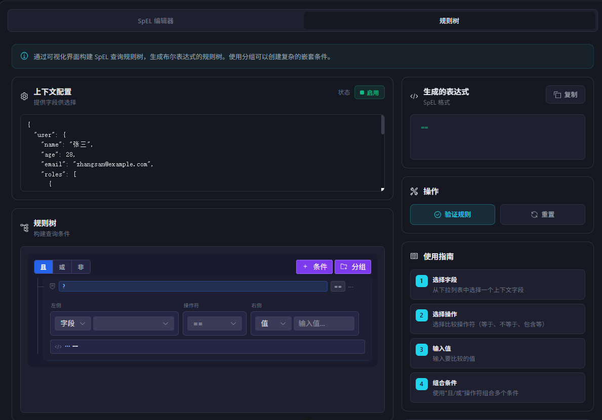
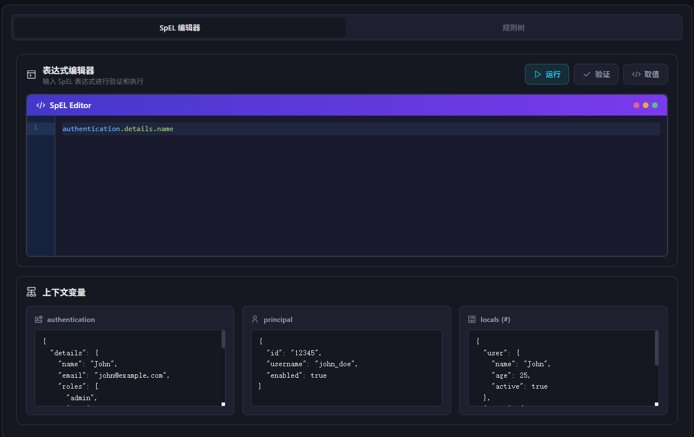

[中文](./README.md) | [English](./README.en.md)

# Vue SpEL Query Builder

Vue 3 SpEL（Spring Expression Language）查询构建器 - 提供在线编辑器与可视化规则树双模式，支持通过代码或可视化界面构建 SpEL 布尔表达式。

## 特性

- **SpEL 编辑器**：基于 CodeMirror 的代码编辑器，支持语法高亮、上下文自动补全、类型提示和表达式执行
- **可视化规则树**：通过拖拽操作构建复杂的布尔表达式规则树，无需编写代码
- **双向转换**：规则树可生成 SpEL 表达式，代码编辑的表达式可可视化展示
- **上下文感知**：支持 `authentication`、`principal`、`locals` 三种上下文变量，提供智能提示
- **主题切换**：内置亮色和暗色主题支持
- **尺寸可选**：提供 `tiny`、`small`、`medium`、`large` 四种尺寸规格
- **国际化**：内置中文（`zh`）/ 英文（`en`）语言包，支持全局、组件 props、配置上下文三种方式切换
- **TypeScript**：完整的 TypeScript 类型定义支持

## 安装

```bash
npm install @zeng-alt/vue-spel-query-builder
# 或
yarn add @zeng-alt/vue-spel-query-builder
# 或
pnpm add @zeng-alt/vue-spel-query-builder
```

## 依赖要求

本组件库依赖以下 peer dependencies（npm 7+ 会自动安装，也可以手动安装）：

```bash
npm install vue@^3.5.0 naive-ui@^2.44.0 \
  @codemirror/autocomplete@^6.20.0 \
  @codemirror/commands@^6.10.0 \
  @codemirror/language@^6.9.0 \
  @codemirror/state@^6.5.0 \
  @codemirror/view@^6.38.0 \
  @lezer/highlight@^1.2.0
```

> **注意**：`RuleTree` 内部使用 naive-ui 组件，naive-ui 已在组件内直接引入，**只需安装 peer dependency 即可**，无需在应用中 `app.use(naive)` 全局注册。
>
> 如果你在自己的模板中也使用 naive-ui 组件，推荐配合 [`unplugin-vue-components`](https://github.com/unplugin/unplugin-vue-components) 按需引入：
>
> ```ts
> // vite.config.ts
> import Components from 'unplugin-vue-components/vite'
> import { NaiveUiResolver } from 'unplugin-vue-components/resolvers'
>
> export default {
>   plugins: [
>     // ...
>     Components({
>       resolvers: [NaiveUiResolver()],
>     }),
>   ],
> }
> ```

> **注意**：使用组件前必须引入样式文件：
>
> ```ts
> import '@zeng-alt/vue-spel-query-builder/style.css'
> ```
>
> 组件所需的工具类样式（flex / 间距 / 阴影等）已内置在该 CSS 中，**使用方无需配置 UnoCSS**。

## 演示




## 快速开始

### 1. SpEL 编辑器模式

通过代码方式编写和验证 SpEL 表达式：

```vue
<script setup lang="ts">
import { ref } from 'vue'
import { SpelEditor } from '@zeng-alt/vue-spel-query-builder'
import '@zeng-alt/vue-spel-query-builder/style.css'

const expression = ref('authentication.details.name')

const authentication = {
  details: {
    name: 'John',
    email: 'john@example.com',
    roles: ['admin', 'user'],
  },
}

const principal = {
  id: '12345',
  username: 'john_doe',
}

const locals = {
  user: {
    name: 'John',
    age: 25,
    active: true,
  },
}
</script>

<template>
  <SpelEditor
    v-model="expression"
    :authentication="authentication"
    :principal="principal"
    :locals="locals"
    :height="300"
    theme="dark"
    size="small"
  />
</template>
```

### 2. 规则树模式

通过可视化界面构建查询规则：

```vue
<script setup lang="ts">
import { ref } from 'vue'
import { RuleTree, createEmptyGroup } from '@zeng-alt/vue-spel-query-builder'
import type { RuleNode } from '@zeng-alt/vue-spel-query-builder'
import '@zeng-alt/vue-spel-query-builder/style.css'

const ruleData = ref<RuleNode>(createEmptyGroup('and'))

const context = {
  user: {
    name: '张三',
    age: 28,
    email: 'zhangsan@example.com',
    roles: [
      { code: 'admin', label: '管理员' },
      { code: 'user', label: '普通用户' },
    ],
    active: true,
  },
  order: {
    id: 'ORD-001',
    amount: 1000,
    status: 'completed',
  },
}

const handleChange = (rule: RuleNode) => {
  console.log('规则变更:', rule)
}
</script>

<template>
  <RuleTree
    v-model="ruleData"
    :authentication="{ details: { name: 'John' } }"
    :principal="{ id: '123' }"
    :locals="context"
    theme="dark"
    size="small"
    @change="handleChange"
  />
</template>
```

## API 文档

### SpelEditor 属性

| 属性             | 类型                                       | 默认值    | 说明                                          |
| ---------------- | ------------------------------------------ | --------- | --------------------------------------------- |
| `modelValue`     | `string`                                   | `''`      | SpEL 表达式内容（v-model 双向绑定）           |
| `authentication` | `Record<string, any>`                      | `{}`      | 认证上下文，字段路径以 `authentication.` 开头 |
| `principal`      | `Record<string, any>`                      | `{}`      | 主体上下文，字段路径以 `principal.` 开头      |
| `locals`         | `Record<string, any>`                      | `{}`      | 本地变量，字段路径以 `#` 开头                 |
| `methods`        | `CustomMethod[]`                           | `[]`      | 自定义方法，编辑器自动补全并可在表达式中调用 |
| `height`         | `string \| number`                         | `300`     | 编辑器高度，像素值或 CSS 高度字符串           |
| `theme`          | `'light' \| 'dark'`                        | `'dark'`  | 主题样式                                      |
| `size`           | `'tiny' \| 'small' \| 'medium' \| 'large'` | `'small'` | 组件尺寸                                      |
| `locale`         | `'zh' \| 'en'`                             | `'zh'`    | 组件语言                                      |
| `localeFallback` | `'zh' \| 'en'`                             | `'zh'`    | 找不到 key 时的回退语言                       |
| `disabled`       | `boolean`                                  | `false`   | 是否禁用编辑                                  |
| `readonly`       | `boolean`                                  | `false`   | 是否只读                                      |

### SpelEditor 事件

| 事件名              | 参数                                 | 说明               |
| ------------------- | ------------------------------------ | ------------------ |
| `update:modelValue` | `(value: string)`                    | 表达式值变更时触发 |
| `change`            | `(value: string)`                    | 内容变化时触发     |
| `validate`          | `(isValid: boolean, error?: string)` | 表达式验证结果     |
| `run`               | `(result: any, error?: string)`      | 表达式执行结果     |

### SpelEditor 方法（通过 ref 调用）

```typescript
const editorRef = ref<SpelEditorInstance>()

// 获取当前表达式值
editorRef.value.getValue()

// 设置表达式值
editorRef.value.setValue('#user.name == "admin"')

// 验证表达式
await editorRef.value.validate()

// 执行表达式
await editorRef.value.run()

// 获取焦点
editorRef.value.focus()
```

### RuleTree 属性

| 属性             | 类型                                       | 默认值    | 说明                                          |
| ---------------- | ------------------------------------------ | --------- | --------------------------------------------- |
| `modelValue`     | `RuleNode`                                 | 必填      | 规则树数据（v-model 双向绑定）                |
| `authentication` | `Record<string, any>`                      | `{}`      | 认证上下文，字段路径以 `authentication.` 开头 |
| `principal`      | `Record<string, any>`                      | `{}`      | 主体上下文，字段路径以 `principal.` 开头      |
| `locals`         | `Record<string, any>`                      | `{}`      | 本地变量，字段路径以 `#` 开头                 |
| `methods`        | `CustomMethod[]`                           | `[]`      | 自定义方法，可用于函数表达式节点             |
| `theme`          | `'light' \| 'dark'`                        | `'light'` | 主题样式                                      |
| `size`           | `'tiny' \| 'small' \| 'medium' \| 'large'` | `'small'` | 组件尺寸                                      |
| `locale`         | `'zh' \| 'en'`                             | `'zh'`    | 组件语言，同时会切换 naive-ui 语言            |
| `localeFallback` | `'zh' \| 'en'`                             | `'zh'`    | 找不到 key 时的回退语言                       |
| `disabled`       | `boolean`                                  | `false`   | 是否禁用操作                                  |

### RuleTree 事件

| 事件名              | 参数                | 说明               |
| ------------------- | ------------------- | ------------------ |
| `update:modelValue` | `(value: RuleNode)` | 规则数据变更时触发 |
| `change`            | `(value: RuleNode)` | 数据变化时触发     |

### RuleTree 方法（通过 ref 调用）

```typescript
const ruleTreeRef = ref<RuleTreeInstance>()

// 获取生成的 SpEL 表达式
ruleTreeRef.value.getSpelExpression()

// 设置 SpEL 表达式（解析中）
ruleTreeRef.value.setSpelExpression('#user.age > 18')

// 验证规则
ruleTreeRef.value.validate()
```

## 自定义方法（methods）

两个组件都支持通过 `methods` 传入自定义方法，编辑器会将其加入自动补全列表，表达式中可直接调用：

```vue
<script setup lang="ts">
import { ref } from 'vue'
import { SpelEditor } from '@zeng-alt/vue-spel-query-builder'
import type { CustomMethod } from '@zeng-alt/vue-spel-query-builder'
import '@zeng-alt/vue-spel-query-builder/style.css'

const expression = ref('isAdmin(#user.roles)')

const methods: CustomMethod[] = [
  {
    name: 'isAdmin',
    argumentCount: 1,
    params: [{ name: 'roles', type: 'array' }],
    returnType: 'boolean',
    description: '判断角色列表是否包含 admin',
    fn: (roles: string[]) => Array.isArray(roles) && roles.includes('admin'),
  },
]
</script>

<template>
  <SpelEditor v-model="expression" :methods="methods" />
</template>
```

> `fn` 提供后，点击运行即可在浏览器中直接执行表达式；`name`、`argumentCount`、`params` 用于自动补全与类型提示。

## 工具函数

### createEmptyGroup

创建一个空的规则分组：

```typescript
import { createEmptyGroup } from '@zeng-alt/vue-spel-query-builder'

// 创建 AND 分组
const andGroup = createEmptyGroup('and')

// 创建 OR 分组
const orGroup = createEmptyGroup('or')

// 创建 NOT 分组
const notGroup = createEmptyGroup('not')
```

### createEmptyCondition

创建一个空的条件节点：

```typescript
import { createEmptyCondition } from '@zeng-alt/vue-spel-query-builder'

const condition = createEmptyCondition()
```

### ruleNodeToSpel

将规则节点转换为 SpEL 表达式字符串：

```typescript
import { ruleNodeToSpel, createEmptyGroup } from '@zeng-alt/vue-spel-query-builder'
import type { RuleNode } from '@zeng-alt/vue-spel-query-builder'

const rule: RuleNode = {
  id: 'root',
  type: 'group',
  operator: 'and',
  children: [
    {
      id: 'cond1',
      type: 'condition',
      left: { type: 'field', path: 'user.age' },
      comparator: '>',
      right: { type: 'literal', value: '18' },
    },
  ],
}

const expression = ruleNodeToSpel(rule)
// 结果: "user.age > 18"
```

## 上下文变量说明

### authentication

认证上下文，通常包含当前用户的认证信息和权限：

```typescript
const authentication = {
  details: {
    name: 'John',
    email: 'john@example.com',
    permissions: ['read', 'write', 'delete'],
  },
  authenticated: true,
}
```

在表达式中使用：`authentication.details.name`

### principal

主体上下文，通常包含用户的主要标识信息：

```typescript
const principal = {
  id: '12345',
  username: 'john_doe',
  roles: ['admin', 'user'],
}
```

在表达式中使用：`principal.username`

### locals

本地变量上下文，通过 `#` 前缀访问：

```typescript
const locals = {
  user: {
    name: '张三',
    age: 28,
  },
  order: {
    amount: 1000,
  },
}
```

在表达式中使用：`#user.name`

## SpEL 表达式示例

### 基础比较

```spel
user.age > 18
user.name == 'admin'
user.active == true
```

### 逻辑运算

```spel
user.age > 18 && user.active == true
user.role == 'admin' || user.role == 'manager'
!(user.age < 18)
```

### 字符串操作

```spel
user.email.contains('@example.com')
user.name.startsWith('John')
user.name.toUpperCase() == 'ADMIN'
```

### 集合操作

```spel
user.roles.contains('admin')
user.tags.size() > 0
```

### 上下文变量

```spel
authentication.details.name == principal.username
#user.age > 18
```

## 国际化（i18n）

组件库内置中文（`zh`）和英文（`en`）两套语言包，默认语言为中文。

### 方式一：全局设置

```ts
import { setLocale } from '@zeng-alt/vue-spel-query-builder'

setLocale('en')
```

### 方式二：组件 props

```vue
<template>
  <RuleTree v-model="ruleData" locale="en" />
  <SpelEditor v-model="expression" locale="en" />
</template>
```

### 方式三：配置上下文（推荐用于局部作用域）

```vue
<script setup lang="ts">
import { SpelConfigProvider, RuleTree, SpelEditor } from '@zeng-alt/vue-spel-query-builder'
</script>

<template>
  <SpelConfigProvider locale="en">
    <RuleTree v-model="ruleData" />
    <SpelEditor v-model="expression" />
  </SpelConfigProvider>
</template>
```

### 扩展/覆盖语言包

```ts
import { setLocaleMessages } from '@zeng-alt/vue-spel-query-builder'

setLocaleMessages('en', {
  ruleTree: {
    group: {
      addCondition: 'Add Condition',
    },
  },
})
```

### 优先级

组件 props > `SpelConfigProvider` 上下文 > 全局 `setLocale()`。

## 主题定制

组件支持通过 CSS 变量进行主题定制：

```css
:root {
  --spel-primary-color: #3b82f6;
  --spel-success-color: #10b981;
  --spel-error-color: #ef4444;
}
```

## 类型定义

### RuleNode 结构

```typescript
interface RuleNode {
  id: string
  type: 'condition' | 'group'

  // 分组专有
  operator?: 'and' | 'or' | 'not'
  children?: RuleNode[]

  // 条件专有
  left?: Expression
  comparator?: string
  right?: Expression
}

interface Expression {
  type: 'literal' | 'field' | 'function'
  value?: string
  path?: string
  call?: FunctionCall
}
```

## 常见问题

### 1. 组件没有样式 / 布局错乱

请确认已引入样式文件：

```ts
import '@zeng-alt/vue-spel-query-builder/style.css'
```

该 CSS 已内置组件所需的全部工具类样式，使用方无需配置 UnoCSS。

### 2. RuleTree 渲染异常（按钮/输入框空白）

`RuleTree` 依赖 naive-ui，请确认已安装该 peer dependency。`RuleTree` 内部已直接引入所需 naive-ui 组件，无需在应用中 `app.use(naive)` 全局注册。

若你的应用模板中也使用 naive-ui 组件，可参考[依赖要求](#依赖要求)使用 `unplugin-vue-components` + `NaiveUiResolver` 按需引入。

### 3. 提示缺少 `@codemirror/*` 依赖

`@codemirror/*`、`@lezer/highlight` 是 peer dependencies，npm 7+ 会自动安装；若使用较旧的包管理器，请参照[依赖要求](#依赖要求)手动安装。

### 4. 编辑器和规则树默认主题不一致？

`SpelEditor` 默认 `dark`，`RuleTree` 默认 `light`，可通过 `theme` 属性统一。

## 浏览器兼容性

- Chrome / Edge 90+
- Firefox 88+
- Safari 14+

## License

MIT
